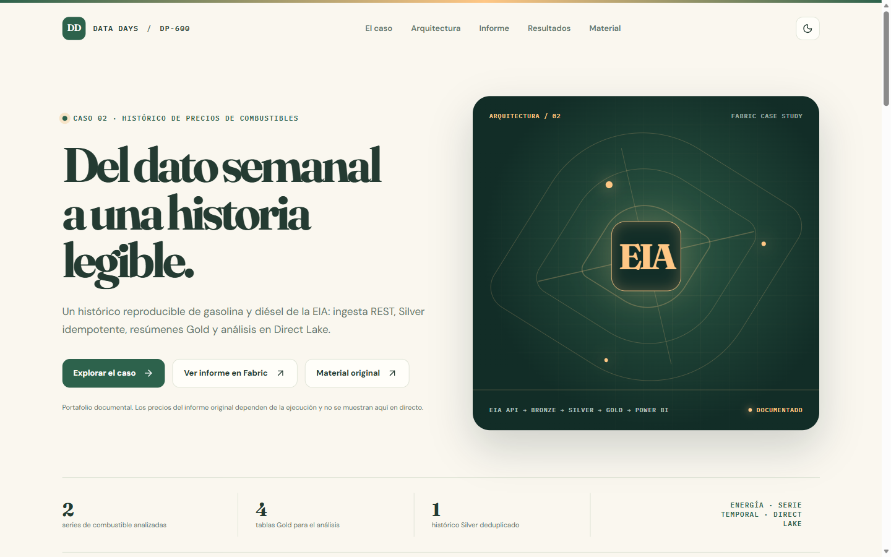
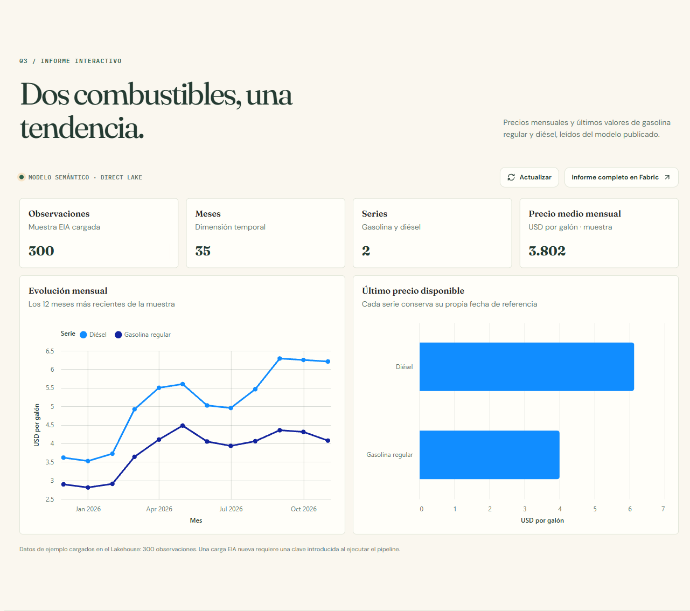

# Data Days · Combustibles

Fabric App tipo portafolio del caso 02 de DP-600: un histórico semanal de gasolina y diésel de la EIA que conserva la respuesta original, deduplica en Silver y sirve resúmenes Gold a un informe Direct Lake. La app describe el método y sus resultados; **no es un monitor de precios en directo**.

**Publicado:** [Fabric App](https://spicy-bloom-1cb1cf0b08-spaincentral.webapp.fabricapps.net) · [Informe Power BI](https://app.fabric.microsoft.com/groups/0245bb51-e0d1-40f1-b071-fcbbf1d7b155/reports/2410449a-d0d7-448d-9dd2-31c1d92a18f6) · workspace `DataDays-FabricApps-Portfolio-DEV` / carpeta `02-Combustibles`. El informe usa la muestra de 300 observaciones; la carga viva requiere clave EIA.

## Explora la solución

| Parte | Contenido |
| --- | --- |
| `packages/frontend/` | Fabric App Rayfin con arquitectura y preguntas del caso |
| [`case-source/docs/`](case-source/docs/) | Guía ilustrada y PDF de la clase |
| [`case-source/notebooks/`](case-source/notebooks/) | Notebooks de Silver y Gold, en `.ipynb` y `.py` |
| [`case-source/pipelines/`](case-source/pipelines/) | Plantilla Copy REST → Silver → Gold |
| [`case-source/powerbi/`](case-source/powerbi/) | PBIP con informe y modelo Direct Lake |
| [`fabric/`](fabric/) | Copias de despliegue con conexiones e identificadores resueltos |
| [`case-source/data/`](case-source/data/) | Respuesta EIA de ejemplo, no una fuente viva |
| [`docs/arquitectura.md`](docs/arquitectura.md) | Flujo fuente → Bronze → Silver → Gold → modelo, con diagramas y relaciones |
| [`docs/proyecto.md`](docs/proyecto.md) | Workspace, carpeta e inventario de recursos de esta app |

Los artefactos proceden del [repositorio general de Data Days](https://github.com/vicente2121/DATADAYS_DP600/tree/main/charla02/caso_02_historico_precios_combustibles). El workspace de Fabric **no está sincronizado con Git**.

## Lo que demuestra

- Bronze conserva una respuesta JSON por ejecución.
- Silver usa MERGE con grano serie y fecha para evitar duplicados.
- Gold prepara dimensiones, evolución mensual y último precio.
- El modelo Direct Lake da continuidad al análisis en Power BI.

## Reproducción y desarrollo

Para reproducir la ingesta viva se necesita una clave propia de EIA, introducida como parámetro de ejecución del pipeline. Nunca se guarda en este repositorio. La guía de réplica está en [`case-source/README.md`](case-source/README.md).

La app requiere Node.js 22.13 o posterior:

```powershell
npm install
npm run typecheck
npm run build
npm run dev
```

Consulta [`docs/rayfin-template.md`](docs/rayfin-template.md) para los comandos de la plantilla oficial.

## Informe dentro de la Fabric App

La sección **Informe** consulta el modelo semántico publicado con el conector delegado de Rayfin. Muestra cuatro indicadores y dos gráficas basados en consultas DAX verificadas, con estado de carga y errores visibles. Consulta [las consultas y los visuales](packages/frontend/src/queries/report/) y el [mapa de datos](docs/arquitectura.md). El informe de Power BI enlazado arriba ofrece las páginas analíticas completas.

## Los tres casos de Data Days

| Caso | Repositorio público | Fabric App |
| --- | --- | --- |
| 01 · Criptomonedas | [Código y arquitectura](https://github.com/vicente2121/datadays-cripto-portfolio) | [Abrir app](https://early-tower-5ef68d90a6-spaincentral.webapp.fabricapps.net) |
| 02 · Combustibles | [Código y arquitectura](https://github.com/vicente2121/datadays-combustibles-portfolio) | [Abrir app](https://spicy-bloom-1cb1cf0b08-spaincentral.webapp.fabricapps.net) |
| 03 · Crossref | [Código y arquitectura](https://github.com/vicente2121/datadays-crossref-portfolio) | [Abrir app](https://rural-unity-56e33da5da-spaincentral.webapp.fabricapps.net) |

Los tres casos comparten un único workspace de Fabric, cada uno en su carpeta. Cada solución tiene su propio repositorio GitHub; el workspace no está conectado a Git.


## Capturas de la app publicada

| Portada | Informe integrado |
| --- | --- |
| [](docs/capturas/portada.png) | [](docs/capturas/informe.png) |

Capturadas en la URL publicada con la cuenta de desarrollo el 22-11-2026. El informe muestra datos consultados al modelo Direct Lake, no una maqueta.
