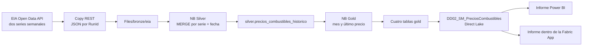
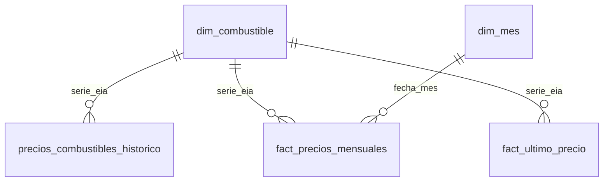

# Arquitectura del caso 02 · precios EIA

La solución está en la carpeta `02-Combustibles` del [workspace Data Days](https://app.fabric.microsoft.com/groups/0245bb51-e0d1-40f1-b071-fcbbf1d7b155/list). La [Fabric App](https://spicy-bloom-1cb1cf0b08-spaincentral.webapp.fabricapps.net) presenta el caso y su informe; el [informe Power BI](https://app.fabric.microsoft.com/groups/0245bb51-e0d1-40f1-b071-fcbbf1d7b155/reports/2410449a-d0d7-448d-9dd2-31c1d92a18f6) ofrece la vista analítica completa.

## Movimiento del dato

| Tramo | Entrada | Salida | Comprobación |
| --- | --- | --- | --- |
| Fuente → Bronze | API EIA con clave aportada al ejecutar | Un JSON por `RunId` | Respuesta original conservada |
| Bronze → Silver | JSON con semanas repetidas | Histórico Delta con grano `serie_eia` + `fecha` | MERGE idempotente, sin duplicados; particiones año/mes |
| Silver → Gold | Precios semanales | Dimensiones de combustible y mes; hechos mensual y último precio | Cada serie conserva su fecha y unidad |
| Gold → análisis | Tablas Delta `gold` y el histórico `silver` | Modelo Direct Lake y dos interfaces de informe | Consulta DAX sobre las series |

La canalización `DD02_PL_EIA_Precios` tiene Copy REST → Silver → Gold. Su ejecución viva requiere una clave EIA que no está en Git. Para la entrega se cargó el JSON de muestra en Bronze y se ejecutaron los dos notebooks: el modelo devolvió **300 observaciones Silver y 35 meses**. Por eso el informe publicado representa la muestra, mientras la canalización está preparada para una carga nueva.

## Modelo de análisis

Las cuatro relaciones son activas y de una dirección. La Fabric App y Power BI leen `DD02_SM_PreciosCombustibles`; los materiales originales y las definiciones publicadas están en [`case-source/`](../case-source/) y [`fabric/`](../fabric/).

## Informe dentro de la Fabric App

La pestaña **Informe** consulta `DD02_SM_PreciosCombustibles` con Rayfin y permisos delegados. Las consultas DAX están en [`packages/frontend/src/queries/report/`](../packages/frontend/src/queries/report/). El panel muestra observaciones, meses, series y el precio mensual promedio; representa doce meses por combustible y compara el último precio disponible de cada serie.

**Comprobación del 22-11-2026:** el DAX devolvió 300 observaciones, 35 meses y dos series a partir del JSON de ejemplo. La app indica que se trata de una muestra. La ejecución del pipeline contra EIA sigue pendiente de una clave aportada por quien lo lance.
